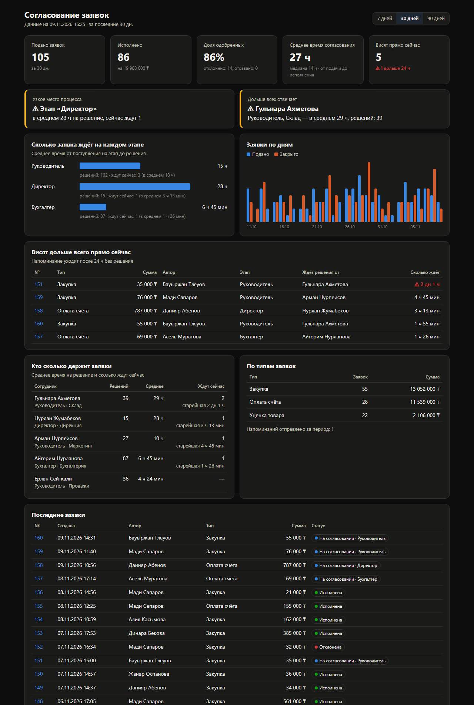

# Согласование заявок: Telegram-бот + Google Таблица + дашборд


## Попробовать

| | |
|---|---|
| 🤖 **Бот** | [@zayavkidemoD_bot](https://t.me/zayavkidemoD_bot) — нажмите Start и подайте заявку. В демо вы проходите все роли сами: сотрудник → руководитель → бухгалтер |
| 📊 **Дашборд** | [zayavki-kz.duckdns.org](https://zayavki-kz.duckdns.org) |
| 📋 **Google Таблица** | [Журнал заявок](https://docs.google.com/spreadsheets/d/1h3YLiy0hXf4A_3s4CeYSgaKhS-QKWarkWr_6mOS2Mys) (только просмотр) — подайте заявку в боте, и через пару секунд она появится здесь |



## Зачем

Заявки на закупку, оплату или уценку часто согласуют в чатах и устно. Они теряются, и никто не знает, где заявка застряла.

Этот проект переводит согласование в понятный процесс:

```
Сотрудник ──► Руководитель ──► (Директор, если сумма ≥ 500 000 ₸) ──► Бухгалтер ──► Исполнено
                   │                        │                            │
                   └────────────── Отклонено (причина обязательна) ──────┘
```

- **Telegram-бот.** Сотрудник подаёт заявку (тип, сумма, описание, фото или файл), согласующие нажимают «Одобрить» или «Отклонить».
- **Маршрут настраивается в файле.** Этапы, пороги сумм и роли меняются без правки кода.
- **Обязательная причина отказа.** Автор всегда знает, почему ему отказали.
- **Напоминания.** Если заявка висит без решения дольше N часов, бот напоминает ответственному.
- **Исправление ошибок без удаления.** Администратор может аннулировать заявку или вернуть её на нужный этап (например, если одобрили по ошибке) — всегда с причиной. Заявки не удаляются: история согласования — это аудит.
- **Журнал в Google Таблице.** Лист «Журнал» (строка на заявку), лист «История» (каждое действие) и лист «Сотрудники» (роли ведутся прямо в таблице).
- **Веб-дашборд.** Показывает, сколько заявок подано и одобрено, среднее время согласования, на каком этапе и у кого заявки застревают.
- **Режим открытого доступа.** Любой пользователь получает все роли и может пройти маршрут целиком — для презентации и приёмочного тестирования.

## Архитектура

```
Telegram ◄──► aiogram (бот) ─┐
                             ├─► ApprovalService (логика маршрута) ─► SQLite / PostgreSQL
Браузер ◄──► FastAPI (дашборд)┘                                          │
                                                       фоновая синхронизация
                                                                          ▼
                                                                  Google Таблица
```

- **База данных — источник правды.** Google Таблица — витрина для людей. Если таблицу случайно испортить, данные не пострадают: журнал раз в 30 минут перезаписывается из базы.
- **Синхронизация переживает сбои.** Изменения помечаются флагом и дописываются в таблицу, как только Google снова доступен.
- **Отказ по умолчанию.** Этап пропускается только по порогу суммы. Если ответственного нет (уволился, неактивен), заявка не «проскакивает» дальше, а ждёт на этапе, и решение поручается администраторам.
- **Защита от двойных нажатий.** У каждой заявки есть версия, поэтому два одновременных решения не перезапишут друг друга.
- **Бизнес-логика отделена от Telegram.** `app/services/approval.py` можно покрыть тестами или подключить к другому интерфейсу.

| Папка / файл | Что внутри |
|---|---|
| `config/workflow.yaml` | Типы заявок, этапы маршрута, пороги, время напоминаний |
| `config/staff.yaml` | Список сотрудников (если Google Таблица не подключена) |
| `app/services/approval.py` | Ядро: маршрут и переходы статусов |
| `app/services/stats.py` | Расчёт метрик для дашборда |
| `app/services/sync.py` | Синхронизация с Google Таблицей |
| `app/integrations/sheets.py` | Работа с Google Sheets API |
| `app/bot/` | Telegram-бот |
| `app/web/` | Дашборд |
| `scripts/seed.py` | Тестовые данные |
| `tests/` | Тесты |

## Быстрый старт

Нужен Python 3.11+.

```bash
python -m venv .venv
.venv\Scripts\activate          # Windows  (Linux/Mac: source .venv/bin/activate)
pip install -r requirements.txt
copy .env.example .env          # Linux/Mac: cp .env.example .env
```

Откройте `.env` и вставьте токен бота в `BOT_TOKEN=` (получить его можно у [@BotFather](https://t.me/BotFather)).

```bash
python -m scripts.seed --reset   # необязательно: тестовые данные для дашборда
python -m app                         # запуск бота и дашборда
```

- Бот: напишите ему `/start`.
- Дашборд: http://127.0.0.1:8000

Без токена запустится только дашборд.

### Сервер (Docker)

На чистом Ubuntu-сервере (например, Oracle Cloud Free Tier):

```bash
sudo bash deploy/setup-server.sh      # Docker, файл подкачки, порты 80/443
docker compose up -d --build          # бот + дашборд + HTTPS
```

В `.env` дополнительно укажите `DOMAIN` (например, `zayavki.duckdns.org`) и `DUCKDNS_TOKEN`.
Caddy сам получит HTTPS-сертификат, контейнер `duckdns` раз в 5 минут обновляет адрес домена.

## Подключение Google Таблицы

1. В [Google Cloud Console](https://console.cloud.google.com/) создайте проект и включите **Google Sheets API** и **Google Drive API**.
2. Создайте **сервисный аккаунт** (IAM → Service Accounts) и скачайте ключ в формате JSON.
3. Положите ключ в `credentials/google-service-account.json`.
4. Создайте пустую Google Таблицу и дайте **доступ редактора** email-адресу сервисного аккаунта (он указан в JSON, поле `client_email`).
5. В `.env` пропишите:
   ```
   GOOGLE_CREDENTIALS_FILE=credentials/google-service-account.json
   GOOGLE_SHEET_ID=<ID из ссылки на таблицу: docs.google.com/spreadsheets/d/<ВОТ_ЭТО>/edit>
   ```

При запуске бот сам создаст листы «Журнал», «История» и «Сотрудники».

## Рабочий режим (для реальной компании)

1. В `.env` поставьте `OPEN_ACCESS=false`, задайте `DASHBOARD_PASSWORD` и администраторов в `ADMINS`.
2. Заполните лист «Сотрудники» (или `config/staff.yaml`):

| Telegram | ФИО | Отдел | Роль | Активен |
|---|---|---|---|---|
| @erlan_seitkali | Ерлан Сейткали | Продажи | руководитель | да |
| @aliya_k | Алия Касымова | Продажи | сотрудник | да |
| 123456789 | Айгерим Нурланова | Бухгалтерия | бухгалтер | да |
| @nurlan_zh | Нурлан Жумабеков | Дирекция | директор | да |

   Роли: сотрудник, руководитель, бухгалтер, директор, администратор. Руководитель отдела — тот, у кого роль «руководитель» в этом отделе. Свой Telegram ID человек может узнать командой `/id`.
3. Настройте маршрут в `config/workflow.yaml` под процессы компании.

Особые случаи:
- **Руководитель подаёт заявку сам.** Себе он не согласует, поэтому заявка уходит директору (`fallback`).
- **Сотрудника убрали из списка.** Он теряет доступ, а история его заявок сохраняется.

## Тесты

```bash
pytest
```

Тесты проверяют маршрут, пороги сумм, обязательную причину отказа, защиту от двойного нажатия, права доступа, напоминания, аннулирование и возврат на этап, поведение при отсутствии ответственного, метрики и синхронизацию списка сотрудников.

## Стек

Python 3.12, aiogram 3, SQLAlchemy 2 (async), SQLite, gspread (Google Sheets API), FastAPI, Jinja2, APScheduler, pytest, ruff, Docker, Caddy (HTTPS).

## Что можно развивать дальше

- Разные маршруты для разных типов заявок, параллельное согласование.
- Замещение согласующего на время отпуска.
- Эскалация руководителю, если напоминание проигнорировано.
- Выгрузка отчётов в Excel и интеграция с 1С или Битрикс24.
- Для промышленной эксплуатации: PostgreSQL, миграции Alembic, ежедневные резервные копии, сервер в стране, где по закону должны храниться персональные данные.
